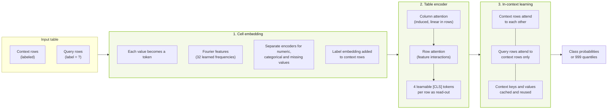
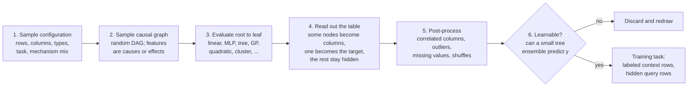
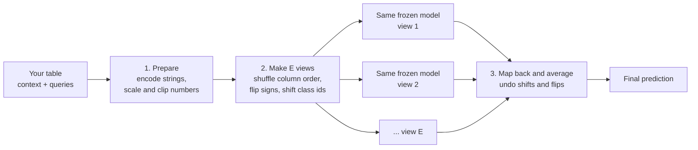

# Kumo Tabular: Architecture and Usage Guide

Kumo Tabular is a pretrained foundation model for tabular data. You give it a table of labeled rows and a set of rows to score, and it returns predictions in a single forward pass. There is no training, tuning or feature engineering step.

This page explains how the model is built, why it is built that way, and how to get good results on real-world tables.

## Overview

Prediction on tables (churn, default, fraud, demand, price) has been dominated by gradient-boosted trees for two decades. Trees work well, but every new task repeats the same cycle: collect labels, engineer features, tune hyperparameters, validate, deploy. Each model learns its task from scratch and knows nothing about tables in general.

Kumo Tabular takes the approach that large language models use for text. An LLM can solve a new task from a few examples in its prompt without updating any weights, which is called in-context learning. Kumo Tabular does the same with a table. It is pretrained on tens of millions of tables, then reads your labeled rows as context and predicts the labels of new rows directly.

| | |
|---|---|
| Tasks | Classification (up to 10 classes per pass, more with error-correcting output codes) and regression |
| Inputs | Numerical and categorical columns. Text, images and timestamps are converted to features by built-in pre-processing recipes |
| Outputs | Class probabilities, or 999 quantiles for regression, which give both a point estimate and an uncertainty estimate |
| Sizes | Small (28M parameters), Medium (62M), Large (about 215M) |
| Pretraining data | Synthetic tables only |
| Benchmarks | Ranked first on TabArena, BeyondArena, TALENT and ScoringBench with default settings |
| Availability | Open weights on [Hugging Face](https://huggingface.co/nvidia/Kumo-Tabular), open-source library [structured-data-models](https://github.com/NVIDIA/structured-data-models), OpenMDW-1.1 license for commercial use |

Because the weights are open and the library runs locally, the model can be used entirely inside your own environment.

### Quick start

```python
import torch
import sdm
from sklearn.datasets import load_breast_cancer

df = load_breast_cancer(as_frame=True).frame
device = torch.device("cuda" if torch.cuda.is_available() else "cpu")

table = sdm.TableTensor.from_pandas(
    df=df,
    stypes=sdm.infer_stypes(df, overrides={"target": "categorical"}),
    device=device,
)

model = sdm.models.KumoTabular(task="classification", device=device)
probs = model(
    x_context=table[:300].drop_columns("target"),   # labeled rows
    y_context=table[:300, "target"],
    x_query=table[300:].drop_columns("target"),     # rows to score
    num_estimators=8,
)
```

## Architecture

A table flows through three stages: cell embedding, a table encoder, and in-context learning. Labeled rows (the context) and unlabeled rows (the queries) pass through the model together.



### Cell embedding

Every cell becomes a token. Numerical and categorical values each have their own encoder, and numbers are passed through Fourier features: sines and cosines of 32 learned frequencies, from coarse to fine. This puts values of very different scales into one shared vector space. Cells are grouped so that feature interactions can begin before attention. Missing values have a dedicated embedding, so no imputation is required. Labels are added to the context tokens.

### Table encoder

The encoder turns each row into a compact vector by alternating two kinds of attention.

- Column attention looks down a single column and learns what a value means within its distribution, for example whether 42 is typical or extreme. It uses induced self-attention with a fixed number of inducing points, so its cost grows linearly with the number of rows.
- Row attention looks across the cells of one row and learns how features interact. Four learnable `[CLS]` tokens join each row and act as its read-out. From this point on, a row is four tokens regardless of how many columns the table has.

### In-context learning

A final transformer operates on the row vectors. Context rows attend to each other, and query rows attend to context rows only. Each prediction therefore depends on the context and the row itself, not on which other rows are scored with it. Since the context never looks at the queries, its keys and values are computed once and reused for later predictions. Query rows use grouped-query attention (Test-GQA), which makes the cache that each prediction reads 4 to 8 times smaller.

The output head produces class probabilities, or 999 quantiles for regression.

### Model sizes

| | Small | Medium | Large |
|---|---|---|---|
| Parameters | 28M | 62M | ~215M |
| Column and row blocks | 4 | 6 | 6 |
| In-context blocks | 12 | 24 | 24 |
| Default ensemble views | 8 | 8 | 16 |

## Design choices and what they buy you

Kumo Tabular belongs to the family of models introduced by TabPFN and TabICL, which combine column, row and in-context attention. The changes are mostly in how each block is built, with the goal of keeping cost manageable on large tables with many rows and columns.

| Design choice | Benefit |
|---|---|
| Pretraining only on synthetic tables that include missing values, heavy tails, noisy labels and high-cardinality categories | The model has seen messy data before it sees yours, and no real or licensed data goes into pretraining |
| Separate cell encoders per data type, with Fourier features and a missing-value embedding | Mixed-scale numeric data and missing values need little or no preprocessing |
| Induced column attention | Cost is linear in rows, so large contexts stay affordable |
| Four `[CLS]` tokens per row | Cost of the final stage does not depend on the number of columns |
| Length-aware attention temperature | Attention stays sharp when a table is longer or wider than anything seen in training |
| Context cache and Test-GQA | The context is encoded once, repeat predictions are cheap, and scores do not depend on which other rows are in the batch |
| 999-quantile output | Distributions and uncertainty from the same pass, not only a point estimate |
| Three-stage context curriculum | Most learning happens on short, cheap tables, with later stages adapting to long ones |
| Ensembling over equivalent views at inference | Accuracy gain with no training |

### Length-aware attention temperature

Softmax attention spreads out as the number of keys grows. Attention that is sharp over a few hundred rows can wash out over tens of thousands, which is the situation whenever a table at inference time is much larger than a typical training table. Kumo Tabular scales each query by a temperature that grows with the logarithm of the number of keys. The coefficient is learned separately for each attention head, and row attention has an additional learned gate. This is the main mechanism behind the model's ability to use contexts longer than the ones it was trained on.

## How the model was trained

Kumo Tabular is pretrained entirely on artificial tables. Each table is sampled from a new random structural causal model (SCM), which is a set of variables, cause-to-effect arrows, and a function for each variable. The generator is a procedural sampler, not a trained model, so it can produce an unlimited supply of tables with new structure each time. It models statistical structure, not column meaning.



1. **Configuration.** Each table draws its own size, column types, task and mixture of mechanisms.
2. **Causal graph.** Features and the target are assigned to nodes of a random directed acyclic graph. Edge density ranges from sparse to dense, and the target can sit anywhere, so features can be causes or effects of it.
3. **Evaluation.** Noise enters at the root nodes and each node applies a randomly drawn function, such as a linear map, a small neural network, a tree, a Gaussian process, or a quadratic or cluster-based function.
4. **Read-out.** Some nodes become numerical or categorical columns and one becomes the target. The rest stay hidden, like the unmeasured causes behind real data.
5. **Post-processing.** Groups of columns are correlated, outliers are clipped, values are standardized and columns shuffled, and missing values are injected in several patterns. Some features are coarsened so duplicate rows can disagree on the label, some categoricals get many levels, and regression targets can be heavy-tailed.
6. **Filtering.** A quick tree-ensemble check discards tables with no learnable signal.

On every table, the model sees most rows with their labels as context and learns to predict the rest, using cross-entropy loss for classification and quantile loss for regression. Classification and regression are trained as separate models.

Training runs in three stages with progressively longer contexts:

| Stage | Context rows | Purpose |
|---|---|---|
| 1 | 1,024 | Longest stage. Teaches the model what tables look like |
| 2 | 400 to 10,240 | Extends to larger tables |
| 3 | Up to 60,000 | Calibrates for large tables |

All stages use up to 100 columns. The Small, Medium and Large models were trained on tens of millions to over a hundred million synthetic tables.

## How predictions are made

Real tables differ from the tables in the pretraining prior, and several properties of a table are arbitrary: column order, the sign of a value, and the numbering of classes. Kumo Tabular uses that to improve accuracy without any training.



No view is special, and each carries its own small error. The errors differ from view to view, so averaging cancels some of them. The default is 8 views for Small and Medium and 16 for Large, and you can use more through the `num_estimators` argument.

## Working with real-world tables

The sections below cover questions that come up most often when applying the model to production-style data.

### Choosing a context when you cannot use all of it

A tree model trains on every row. Kumo Tabular predicts from the context you give it, so which rows you include, and how many, directly affects results. Context size is also the main driver of memory use and latency. When using the full training set is too expensive, these are the options to try:

- **Stratify by label.** Control the share of each class in the context. If you change the base rate, check calibration afterwards, because predicted probabilities shift with it.
- **Use a recency window.** For data that drifts over time, draw the context from the period closest to the one you are scoring.
- **Retrieve per query.** Use the nearest neighbors of each query row as its context. This can improve relevance but gives up the shared context cache, so it costs more per row.
- **Ensemble several contexts.** Draw independent samples, predict with each, and average. The library supports this.

None of these is a built-in default, so evaluate them on your own validation data. A useful first experiment is to sweep context size (for example 300, 1K, 10K, 50K and 100K rows) on a fixed holdout and see where the gain flattens. That curve tells you how much extra context is worth paying for.

### Missing values and default values

Missing values are handled natively. They get a dedicated embedding, and pretraining includes several missingness patterns (random, structured, near-empty columns, and missingness driven by a hidden factor), so you do not need to impute them. Missingness can itself carry signal, and the model can use it.

Default values need more care. A placeholder such as `0` or `-1` that actually means "not available" looks like a real measurement to the model. Convert true placeholders to `NaN`, and keep genuine zeros as they are.

### Special-value codes

Some datasets use codes outside the normal range to mark conditions such as "no record" or "not applicable", often with very large absolute values like `9999999` or `-999`. These can distort a column. The architecture mitigates this to some degree, since column attention learns what is typical or extreme within each column and the pretraining prior clips outliers. However, there is no dedicated sentinel-value mechanism, so handle them in preprocessing:

1. Map the codes to `NaN`.
2. If the code itself is informative, add an indicator column (for example `col_is_special`), using one indicator per distinct meaning.
3. Compare results with and without the indicators on your validation data.

### Time-ordered data

Kumo Tabular treats rows as a set rather than a sequence, so the order of rows is not used as a signal. Temporal patterns, including autoregressive or moving-average behavior, should be expressed as columns: lags, rolling means and standard deviations, differences, trends, seasonality indicators, and time-since-event features.

For evaluation, use an out-of-time split rather than a random one, and combine it with a recency-aware context as described above. Long event sequences, such as raw transaction histories, are better handled by a sequence model. Its outputs can then be supplied to Kumo Tabular as extra columns.

### Tables larger than the pretraining range

The model was pretrained with up to 60,000 context rows and up to 100 columns, but the architecture is designed to extrapolate beyond that.

| Dimension | Pretraining range | Beyond it |
|---|---|---|
| Context rows | Up to 60,000 | Induced column attention keeps cost linear, and length-aware temperature keeps attention sharp. Accuracy can degrade far past the training range, so check a holdout |
| Columns | Up to 100 | Row compression keeps the later stages independent of column count. Very wide tables (hundreds of columns) are less proven, so consider feature selection or an ensemble over feature groups |
| Classes | Up to 10 per pass | Any number, using error-correcting output codes |

In practice the limits are GPU memory and latency rather than a hard cap in the open-source library. The hosted NIM endpoint limits the context to about 10K rows, so larger contexts need the library on your own GPUs. Also watch for distribution shift between the context and the query rows, which can reduce accuracy and calibration.

### Comparison with other tabular foundation models

Kumo Tabular follows the column, row and in-context attention design introduced by TabICL and TabPFN, and its three-stage training schedule follows TabICLv2. The differences are in the pieces listed under design choices: the breadth of the synthetic prior, per-type Fourier cell embeddings, induced column attention with row compression, length-aware temperature, the context cache with Test-GQA, and the quantile output head.

Published benchmark results show Kumo Tabular ranked first on TabArena, BeyondArena, TALENT and ScoringBench. Results on a particular dataset vary, so the most reliable comparison is on your own data with a split that matches how the model will be used.

### Synthetic training tasks

The model is trained on classification and regression tasks, as separate models. The variety comes from the synthetic prior: each table has its own shape, mechanism mix, graph density, missingness, coarsened features, many-level categoricals and heavy-tailed targets. Tasks are generated procedurally and filtered for learnable signal, rather than identified from real data. The training recipe and data generators are planned for public release.

## References

- Blog: [NVIDIA Kumo Tabular Sets a New Accuracy-Efficiency Frontier for Tabular Prediction](https://huggingface.co/blog/nvidia/kumo-tabular) (Hugging Face, September 29, 2026)
- Model weights: [nvidia/Kumo-Tabular](https://huggingface.co/nvidia/Kumo-Tabular)
- Code: [NVIDIA/structured-data-models](https://github.com/NVIDIA/structured-data-models)
- Müller et al., *Transformers can do Bayesian inference*, ICLR 2022
- Hollmann et al., *TabPFN: a transformer that solves small tabular classification problems in a second*, ICLR 2023
- Qu et al., *TabICLv2: a better, faster, scalable, and open tabular foundation model*, ICML 2026
